# PharmaCare — Pharmacy Management System

A complete, modern pharmacy POS and management system: fast checkout, expiry-safe (FEFO) inventory, prescriptions with AI scanning, drug-interaction alerts, invoices & returns, profit reports, staff roles and a full activity log. Light and dark themes, works on desktop, tablet and phone.

Built with **Laravel 13**, **Inertia** and **React + TypeScript**.

> **Live demo:** _add your demo link here_ · one-click sign-in for every role

<p>
  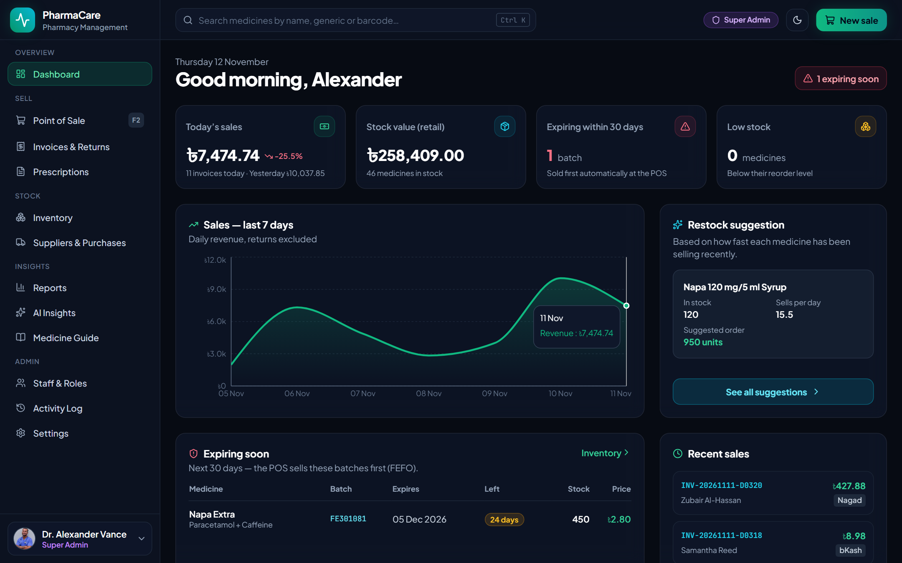
  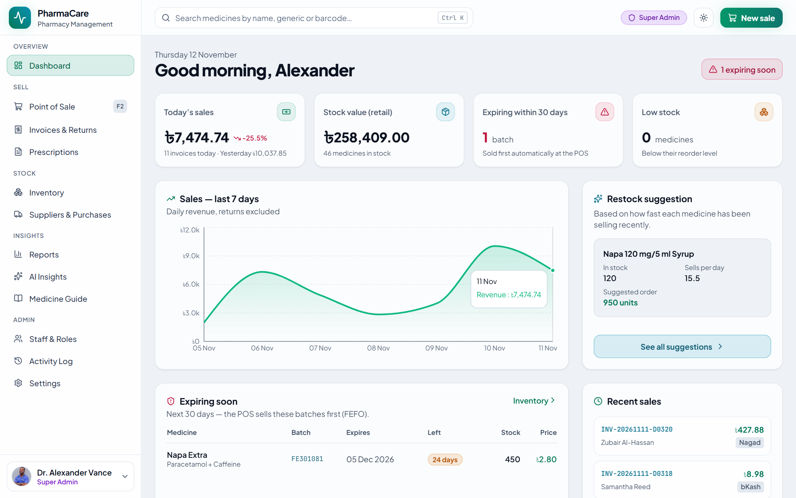
</p>

## Features

**Sell**
- Point of sale with barcode scanning, search by brand or generic, keyboard shortcuts (F2 search · F8 pay · F9 hold)
- Cash, card, bKash, Nagad, split and credit (due) payments; discounts and VAT
- Hold and resume orders, thermal (58/80 mm) and A4 receipts
- Invoices with reprint, due collection and returns that restock automatically

**Stock**
- Medicines, batches and expiry dates; Box → Strip → Piece unit conversion
- **FEFO**: the POS always sells the batch closest to expiry first
- Low-stock and expiring-soon alerts, stock adjustments with reasons
- Suppliers, purchase orders and goods receiving

**Clinical & AI**
- Prescription photo scanning (Google Gemini or OpenAI — bring your own key)
- Drug–drug interaction alerts at the counter
- Medicine guide with dosage, side effects and alternatives (openFDA & RxNorm lookup)
- Restock suggestions from recent sales speed

**Business**
- Dashboard with today vs yesterday, 7-day sales and restock suggestions
- Reports: profit & loss, sales by staff, stock value, controlled drugs, customer dues; CSV export
- Four roles — Super Admin, Pharmacist, Cashier, Inventory Manager — enforced on the server
- Activity log of sign-ins, stock changes, deletions and controlled-drug sales
- Store branding, receipt layout, currency and VAT from the Settings screen
- Light / dark / system theme; responsive down to 360 px phones

## Screenshots

| | |
|---|---|
| 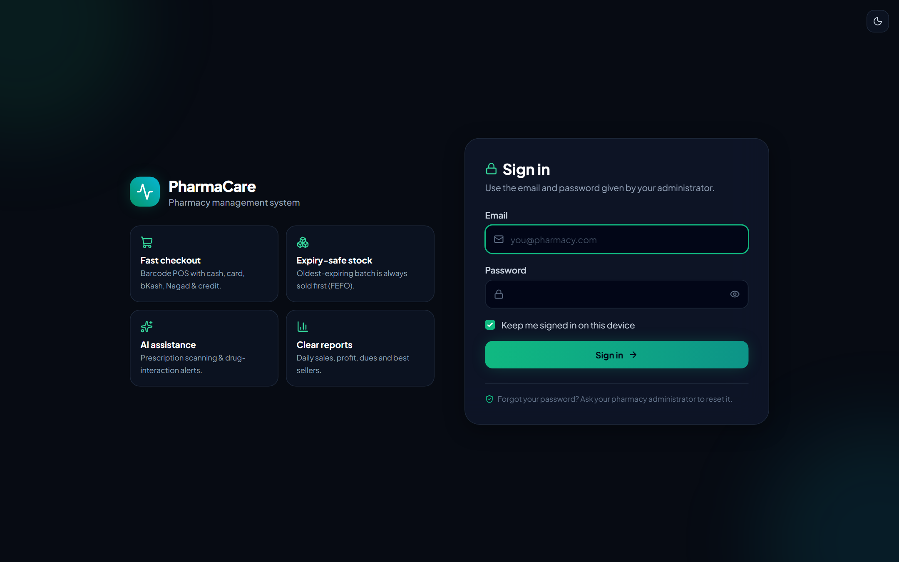 | 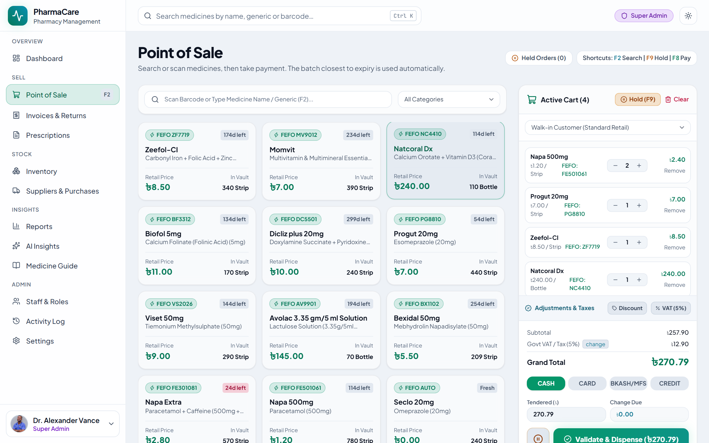 |
| 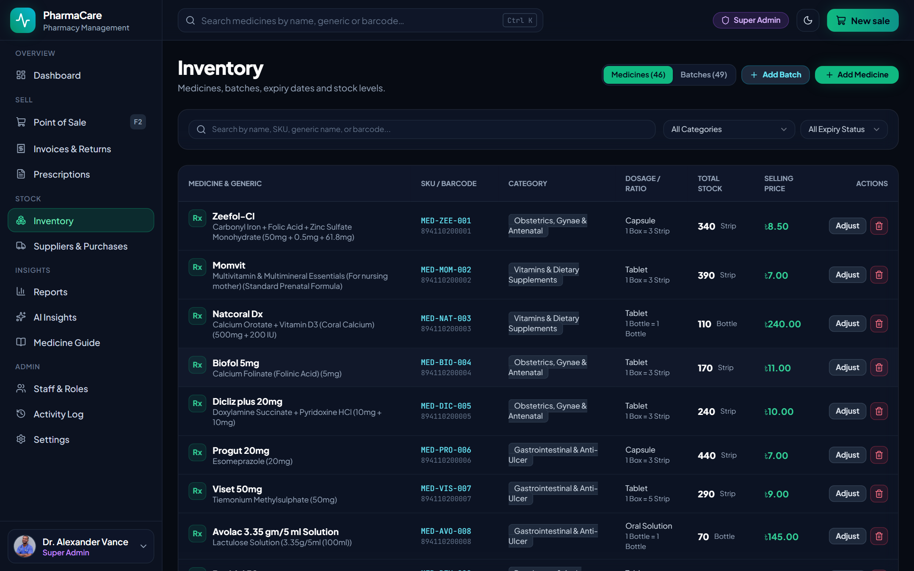 | 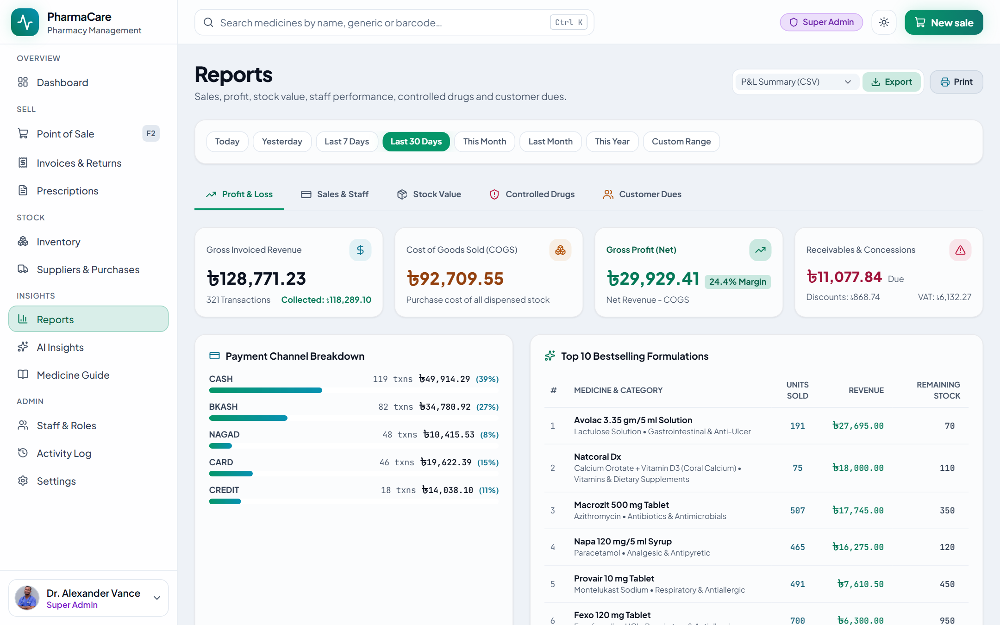 |
| 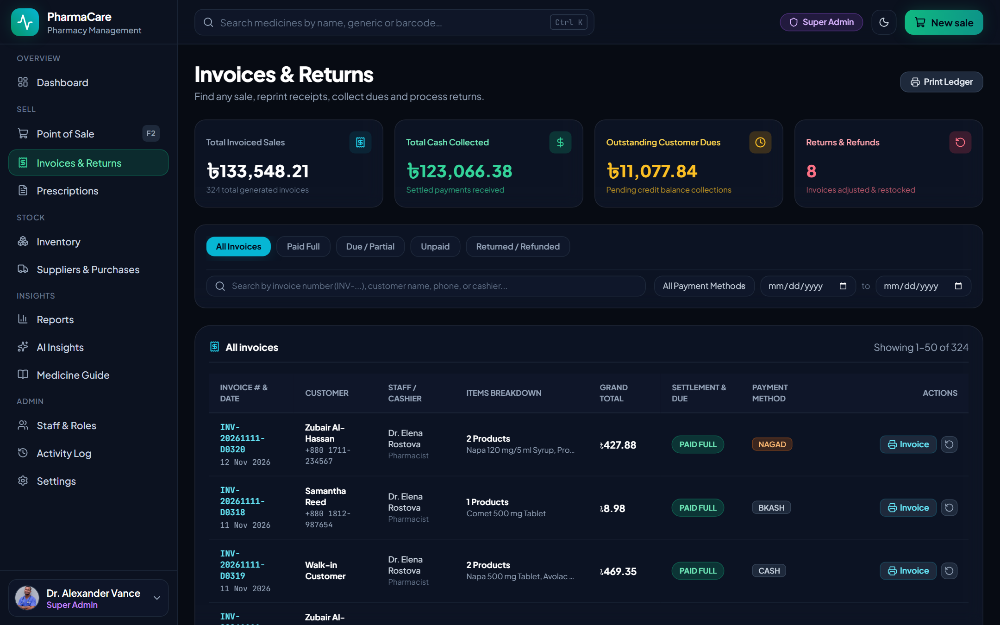 | 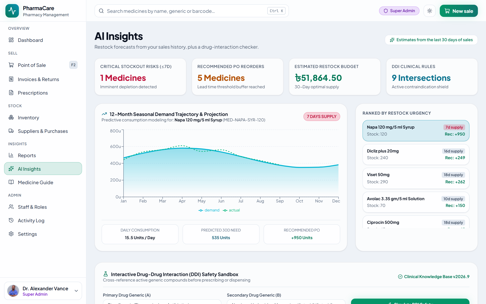 |

<p align="center">
  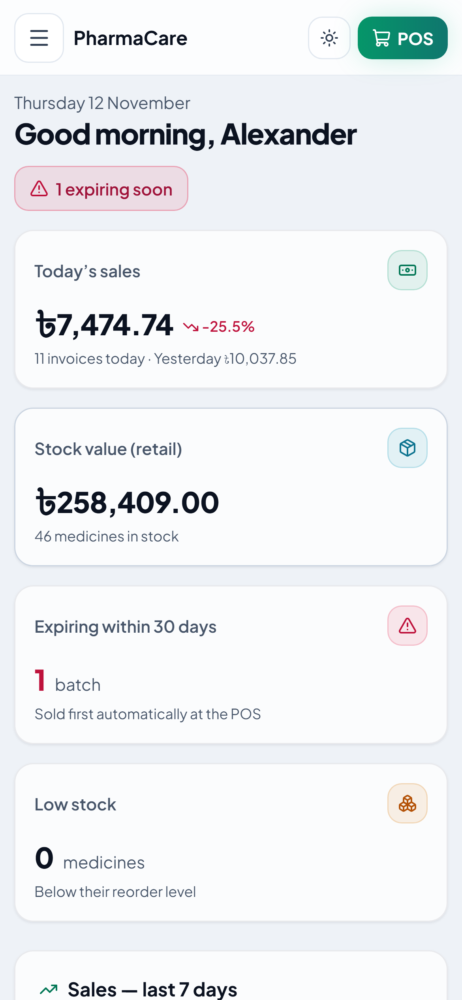
  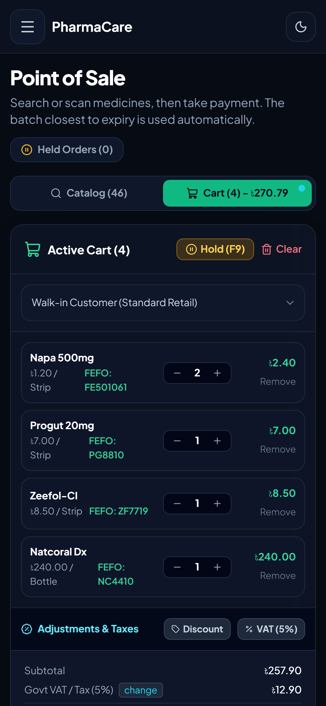
  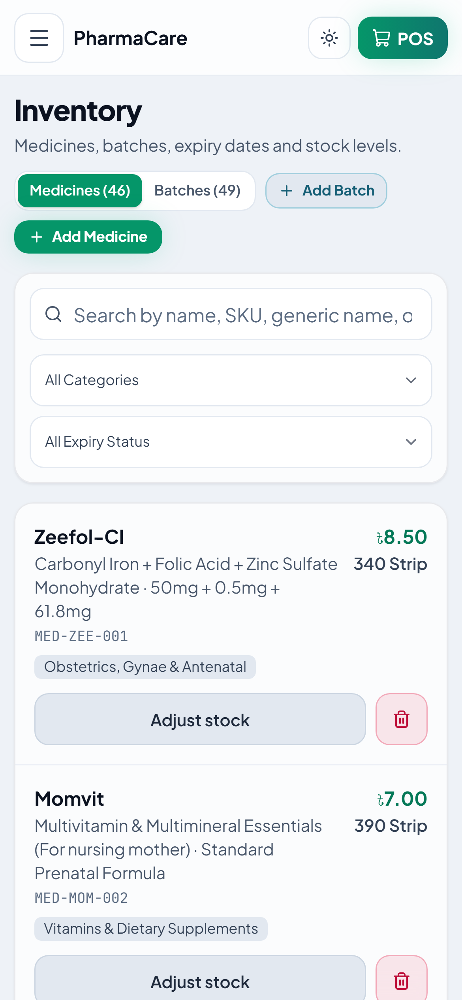
  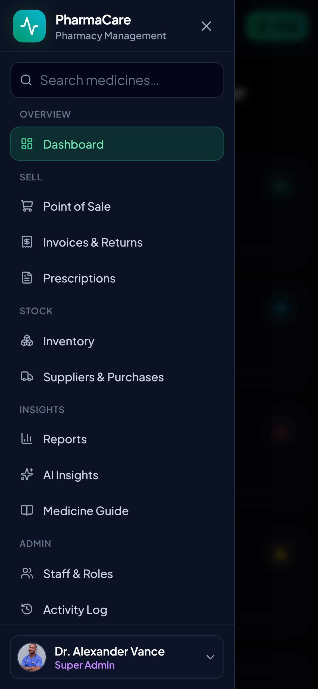
</p>

## Requirements

- PHP 8.3+ with `pdo_mysql` (or `pdo_sqlite`), `mbstring`, `openssl`, `fileinfo`, `curl`, `xml`
- MySQL 8+ or MariaDB 10.6+ (SQLite works for a single counter)
- A web server pointing to the `public/` folder (Apache, Nginx, or cPanel shared hosting)
- Node.js 20+ **only** if you change the front-end code — compiled assets are included

## Quick start

```bash
cp .env.example .env          # then set DB_* and APP_URL
php artisan key:generate
php artisan pharmacare:install
```

The installer creates the tables, loads the medicine reference data (categories, generics, interaction rules) and asks for your pharmacy name and the first admin account. Choose **Demo data** instead to explore with sample staff, medicines and 30 days of sales.

Full guides:

- [Installation (shared hosting, VPS, local)](docs/INSTALLATION.md)
- [User guide — daily tasks for each role](docs/USER-GUIDE.md)
- [Hosting a public live demo](docs/LIVE-DEMO.md)
- [Changelog](CHANGELOG.md)

## Development

```bash
composer install && npm install
npm run dev              # Vite dev server
php artisan serve
php artisan test         # feature & access-control tests
npm run typecheck        # TypeScript
npm run build            # production assets
```

Theme colours live in `scripts/generate-theme.cjs` (run `npm run theme:generate` after editing).

## License

Commercial software — see [LICENSE.md](LICENSE.md).
