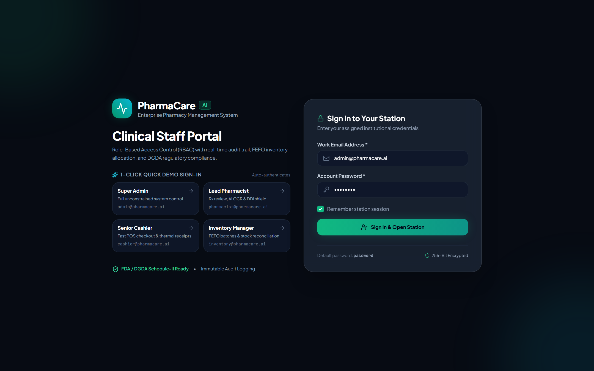
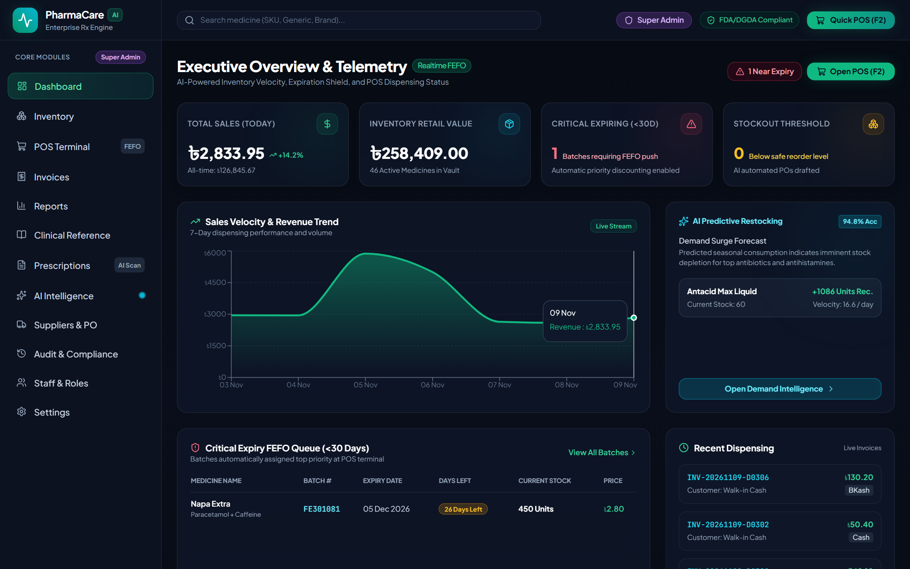
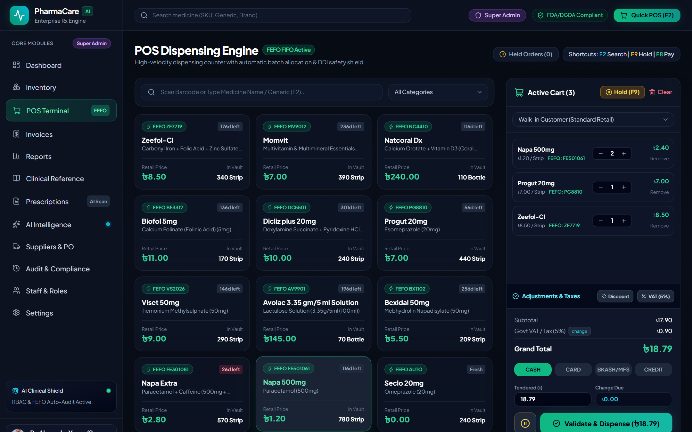
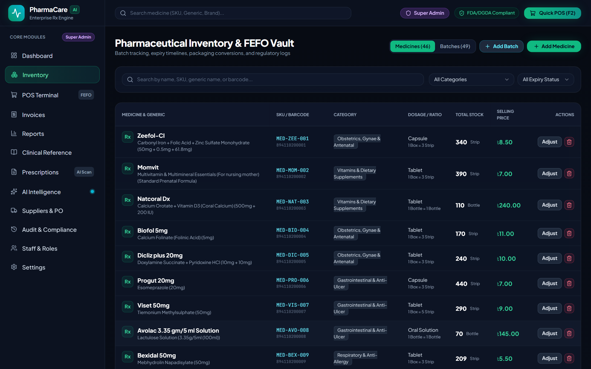
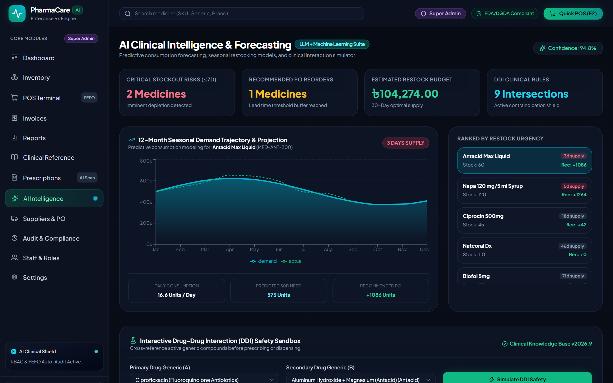
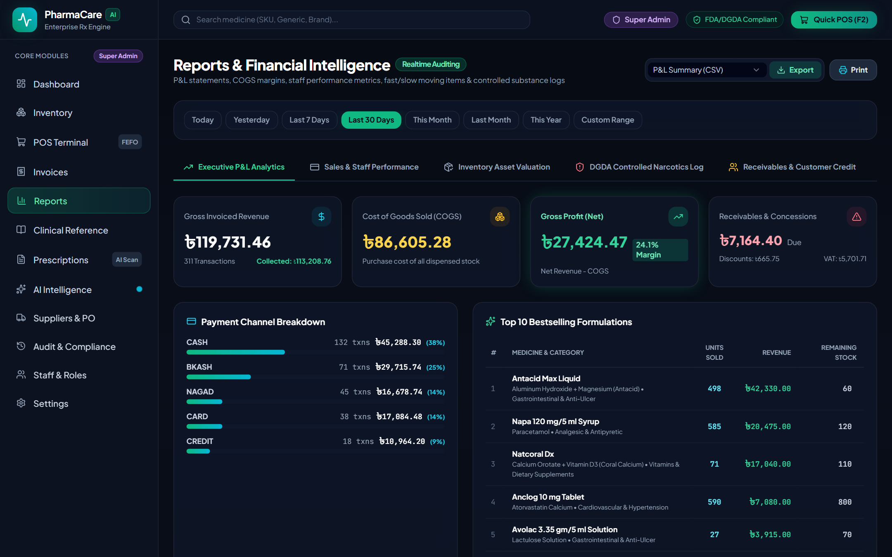
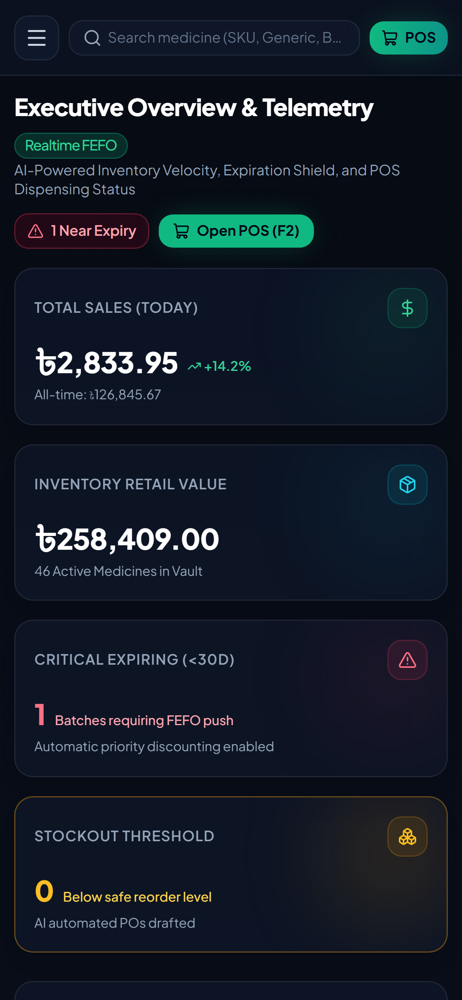
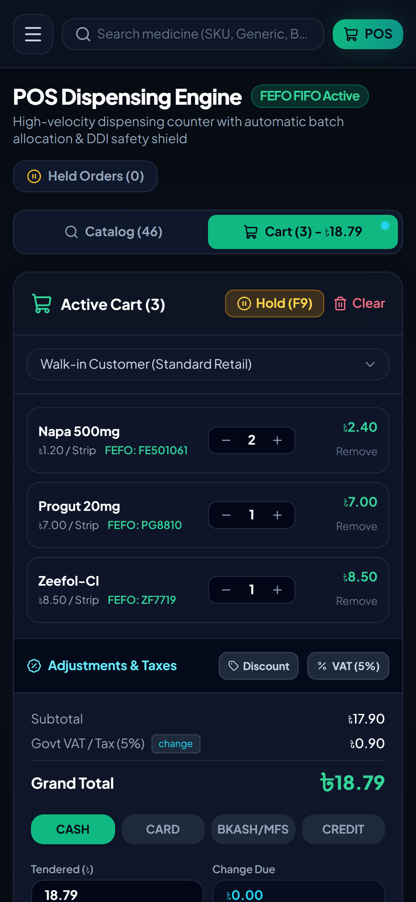

# PharmaCare AI — Modern Pharmacy Management System

Laravel 13 + Inertia (React/TypeScript) pharmacy suite: FEFO-aware POS, batch & expiry inventory, AI prescription OCR, drug–drug interaction (DDI) shield, demand forecasting, P&L reports, RBAC and audit trail. Built mobile-first with a dark clinical UI.

> **Live demo:** _coming soon_

## Screenshots

| Login (1-click demo roles) | Executive dashboard |
|---|---|
|  |  |

| POS with FEFO batch allocation | Inventory & FEFO vault |
|---|---|
|  |  |

| AI forecasting & DDI sandbox | Reports & P&L |
|---|---|
|  |  |

<p align="center">
  
  &nbsp;&nbsp;
  
</p>

## Features

- **POS & dispensing** — barcode/keyword search, FEFO batch auto-pick, hold orders, discounts, VAT, split payments (Cash / Card / bKash / Nagad / Credit)
- **Inventory** — medicines, batches, expiry tracking, unit conversions (Box → Strip → Piece), stock adjustments
- **AI** — prescription image OCR, seasonal demand forecasting, restock recommendations, DDI checker
- **Finance** — invoices, due collection, returns, P&L / COGS, payment channel breakdown, CSV export
- **Compliance** — role-based access (Super Admin, Pharmacist, Cashier, Inventory Manager), immutable audit log, controlled-substance log

## Demo accounts

All passwords are `password`.

| Role | Email |
|---|---|
| Super Admin | admin@pharmacare.ai |
| Lead Pharmacist | pharmacist@pharmacare.ai |
| Senior Cashier | cashier@pharmacare.ai |
| Inventory Manager | inventory@pharmacare.ai |

## Local setup

```bash
composer install
cp .env.example .env && php artisan key:generate
# set DB_* in .env (MySQL)
php artisan migrate --seed
php artisan db:seed --class=DemoSalesSeeder   # 30 days of realistic sales for charts/reports
npm install && npm run build
php artisan serve
```

`DemoSalesSeeder` is idempotent and date-relative — re-run it any time to refresh the last 30 days of demo sales.

## License

MIT
